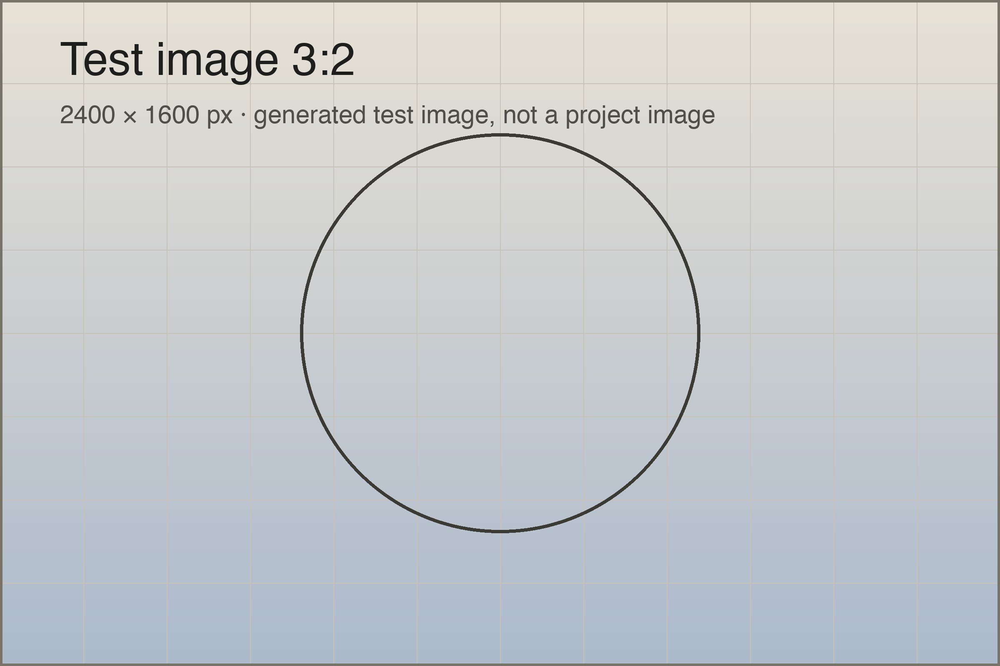
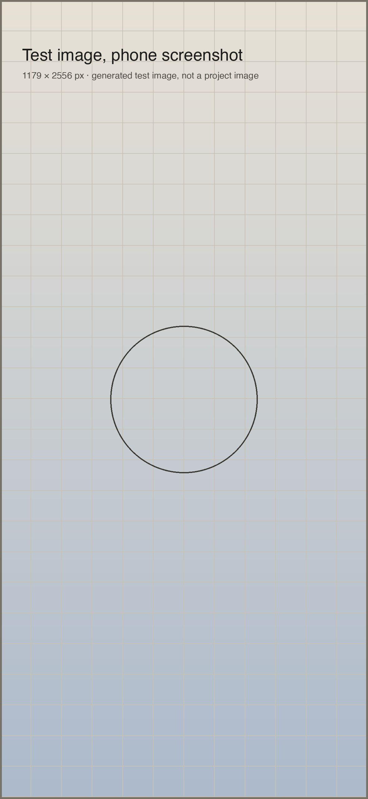

Call me Ishmael. Some years ago – never mind how long precisely – having little or no money in my purse, and nothing particular to interest me on shore, I thought I would sail about a little and see the watery part of the world. It is a way I have of driving off the spleen and regulating the circulation.

## Problem

Whenever I find myself growing grim about the mouth; whenever it is a damp, drizzly November in my soul; whenever I find myself involuntarily pausing before coffin warehouses, and bringing up the rear of every funeral I meet; then, I account it *high time* to get to sea as soon as I can.

This is my substitute for pistol and ball. With a philosophical flourish Cato throws himself upon his sword; I quietly take to the ship. There is nothing surprising in this. If they but knew it, almost all men in their degree, some time or other, cherish very nearly the same feelings towards the ocean with me.



There now is your insular city of the Manhattoes, belted round by wharves as Indian isles by coral reefs – commerce surrounds it with her surf. Right and left, the streets take you waterward.

## Decisions

Circumambulate the city of a dreamy Sabbath afternoon. Go from Corlears Hook to Coenties Slip, and from thence, by Whitehall, northward. What do you see?

- Posted like silent sentinels all around the town, stand thousands upon thousands of mortal men fixed in ocean reveries.
- Some leaning against the spiles; some seated upon the pier-heads.
- Some looking over the bulwarks of ships from China; some high aloft in the rigging, as if striving to get a still better seaward peep.

### A smaller heading inside a section

But look! here come more crowds, pacing straight for the water, and seemingly bound for a dive. Strange! Nothing will content them but the extremest limit of the land.

1. Tell me, does the magnetic virtue of the needles of the compasses of all those ships attract them thither?
2. Once more. Say you are in the country; in some high land of lakes.
3. Take almost any path you please, and ten to one it carries you down in a dale, and leaves you there by a pool in the stream.

> Yes, as every one knows, meditation and water are wedded for ever.

## Outcome

Now, when I say that I am in the habit of going to sea whenever I begin to grow hazy about the eyes, and begin to be over conscious of my lungs, I do not mean to have it inferred that I ever go to sea as a passenger. For to go as a passenger you must needs have a purse, and a purse is but a rag unless you have something in it.



Inline code such as `hugo server` must not make its line taller. A block of code keeps the grid as well:

```sh
hugo server
node tools/raster-check.mjs
```

## What I learned

No, when I go to sea, I go as a simple sailor, right before the mast, plumb down into the forecastle, aloft there to the royal mast-head. True, they rather order me about some, and make me jump from spar to spar, like a grasshopper in a May meadow. **And at first, this sort of thing is unpleasant enough.** Back to the [project overview](/projects/).
